<p align="center">
  
</p>

<p align="center">
  <a href="https://samadpls.com"></a>
  <a href="LICENSE"></a>
  <a href="https://huggingface.co/datasets/ai4bharat/IndicVoices"></a>
  
</p>

<p align="center">
  <b>End-of-turn detection for Urdu voice agents.</b><br>
  At every pause, it decides whether the speaker has finished (reply now) or is only pausing mid-sentence (keep listening).
</p>

---

baari (باری) means "turn" in Urdu. The table below shows that today's turn detectors often cut Urdu
speakers off mid-sentence, or wait after they have finished. baari is a small audio model trained to
get this right. It follows the [Smart Turn](https://github.com/pipecat-ai/smart-turn) recipe and takes
the same input and output, so it can stand in for Smart Turn.

**Status: work in progress.** Done so far: the Urdu test set, the scores of existing models, and
labels for 61,251 training segments. The training code is in place. The first model hasn't been
trained yet.

## 🎧 Do existing models understand Urdu?

1,588 clips of real Urdu phone conversations, cut from the official held-out split of IndicVoices: 1,470
where the speaker had finished and 118 where they were pausing mid-sentence. Because most clips are
"finished", a model that always says "finished" gets 92.6% plain accuracy, so the fair score is the
average of the two middle columns (balanced accuracy).

| Model | Balanced accuracy (95% CI) | Waits when unfinished | Replies when finished |
|---|---|---|---|
| Always says "finished" (reference) | 50.0% | 0.0% | 100.0% |
| Smart Turn v3.2 (CPU, int8) | 63.8% (59.3–68.5) | 58.5% | 69.2% |
| Smart Turn v3.2 (GPU, fp32) | 58.8% (54.8–63.0) | 76.3% | 41.3% |
| Indic Smart Turn tiny (int8) | 74.0% (69.5–78.3) | 61.9% | 86.1% |
| Indic Smart Turn tiny (fp32) | 70.0% (65.8–74.4) | 51.7% | 88.4% |
| Indic Smart Turn base (fp32) | 70.9% (66.5–75.4) | 47.5% | 94.4% |
| PuristanLabs1/urdu-turn-v2 (Urdu) | 51.8% (48.4–55.4) | 16.9% | 86.7% |

Scored on a MacBook Pro (M3 Pro). int8 results shift by a few points between Arm and x86 CPUs; fp32
results do not.

<details>
<summary>How the test set was made</summary>

- **Source:** the conversation recordings in the `valid` split of
  [IndicVoices](https://huggingface.co/datasets/ai4bharat/IndicVoices) Urdu (CC BY 4.0): 1,654 segments,
  81 calls, 80 speakers, 1.7 hours. Each segment ends at a pause.
- **Labels:** two LLM agents each read every call's transcript in order and marked whether the speaker
  had finished at the end of each segment ([prompt](prompts/label.md)). They agreed on 96.0%. Agreed
  segments form the test set; the 66 others are kept apart as `test_ambiguous`.
- **Clips:** the last 8 s of 16 kHz audio ending at the segment, with the speaker's preceding segments
  as context, the same recipe as [Indic Smart Turn](https://github.com/adimyth/indic-smart-turn).
- **Checked by ear:** a native speaker listened to 50 random clips. All 25 "finished" labels were
  right, and 19 of 25 "unfinished" labels were. In the wrong ones the words stop mid-sentence but the
  voice sounds finished, which a transcript cannot show. So roughly 1 in 4 "unfinished" clips may
  really be finished, and the "waits when unfinished" column is a rough measure.
- **Leakage:** 70 of the 80 test speakers, and the other side of 57 of the 81 test calls, also appear in
  the IndicVoices `train` split. Any training data will leave out those speakers and calls.

</details>

## 🛠️ Run it

```bash
uv sync --extra pipeline
echo "HF_TOKEN=..." > .env          # accept the IndicVoices terms on Hugging Face first
uv run baari scan --split valid     # index the conversation segments (text only)
uv run baari batches                # label batches for the LLM agents
# the agents write data/labels/valid/results/{a,b}/batch-*.jsonl
uv run baari build                  # cut the 8 s clips
uv run baari evaluate               # score the existing models
```

<details>
<summary>Training</summary>

The same steps on the IndicVoices `train` split, with one labeler. Test speakers and both sides of
test calls are left out, and about 5% of the remaining speakers form a dev split that picks the best
epoch.

```bash
uv run baari scan --split train
uv run baari batches --split train
# the agents write data/labels/train/results/a/batch-*.jsonl
uv run baari build --split train --labelers a --delete-shards
uv run baari train                  # fine-tune Indic Smart Turn tiny, export fp32 and int8 ONNX
```

Training starts from Indic Smart Turn tiny. That model ships only as ONNX, so `baari train` first
reads its weights back into PyTorch. The [kaggle](kaggle) folder runs the clip build and the
training on Kaggle.

</details>

---

<p align="center">
  <a href="docs/CREDITS.md">Credits</a> · <a href="CONTRIBUTING.md">Contributing</a> · <a href="LICENSE">BSD-2-Clause license</a><br>
  Made by <a href="https://samadpls.com">Abdul Samad</a> (abdulsamadsid1@gmail.com)
</p>
