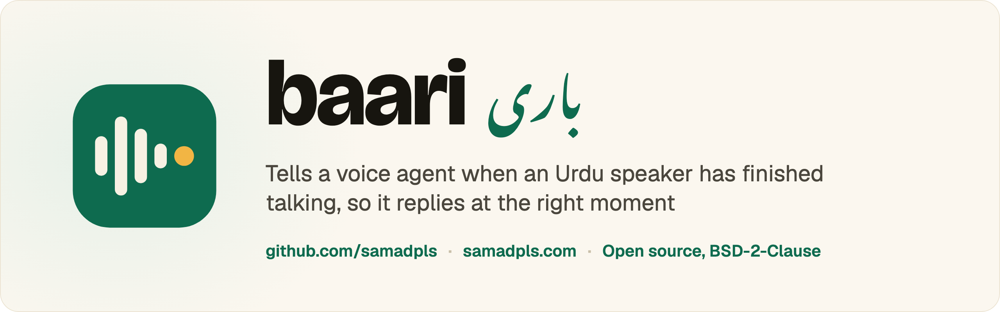

<p align="center">
  
</p>

<p align="center">
  <a href="https://github.com/samadpls/baari"></a>
  <a href="https://pypi.org/project/baari/"></a>
  <a href="https://samadpls.com"></a>
  
</p>

# baari

**End-of-turn detection for Urdu voice agents.** At every pause, baari decides whether the speaker has
finished (reply now) or is only pausing mid-sentence (keep listening). baari (باری) means "turn" in Urdu.

It is Indic Smart Turn tiny, fine-tuned on Urdu phone conversations. It takes the same input and gives
the same output as [Smart Turn](https://github.com/pipecat-ai/smart-turn), so in Pipecat it replaces
Smart Turn with one line.

## 📊 Results

The test set has 1,588 clips of real Urdu phone conversations from the held-out `valid` split of
IndicVoices: 1,470 where the speaker had finished and 118 where they were pausing mid-sentence. No test
speaker, and neither side of any test call, is in the training data. Because most clips are "finished",
the fair score is balanced accuracy, the average of the two right-hand columns. A model that always
says "finished" gets 50%.

| Model | Balanced accuracy (95% CI) | Waits when unfinished | Replies when finished |
|---|---|---|---|
| **baari int8** (default) | **77.0%** (72.9–81.0) | 62.7% | 91.4% |
| **baari fp32** | **76.8%** (72.4–80.7) | 63.6% | 89.9% |
| Indic Smart Turn tiny (int8) | 73.4% (69.0–77.8) | 61.0% | 85.9% |
| Indic Smart Turn base (fp32) | 70.9% (66.5–75.4) | 47.5% | 94.4% |
| Indic Smart Turn tiny (fp32) | 70.0% (65.8–74.4) | 51.7% | 88.4% |
| Smart Turn v3.2 (CPU, int8) | 63.4% (58.8–68.1) | 57.6% | 69.2% |
| Smart Turn v3.2 (GPU, fp32) | 58.8% (54.8–63.0) | 76.3% | 41.3% |
| PuristanLabs1/urdu-turn-v2 | 51.8% (48.4–55.4) | 16.9% | 86.7% |

- Scored on the CPU of a MacBook Pro (M3 Pro), with the same audio preparation Pipecat uses.
- **int8 scores depend on the CPU.** baari int8 gets 77.0% on Arm (Apple) and 74.9% on x86 (Intel and
  AMD, which most servers use). fp32 gets 76.8% on both.
- On the same clips, baari fp32 beats Indic Smart Turn tiny int8 by 3.3 points (paired bootstrap, 95% CI
  +0.3 to +6.4), and its own starting point, Indic Smart Turn tiny fp32, by 6.7 points (+3.8 to +10.0).

## 🚀 Use it

```bash
pip install baari
```

```python
from baari import TurnDetector

detector = TurnDetector(threads=4)  # downloads baari-int8.onnx once
detector.is_finished(audio, sample_rate=16000)  # mono audio (float or int16) that ends at the pause
detector.probability(audio, sample_rate=16000)  # the same decision as a number from 0 to 1
```

In [Pipecat](https://github.com/pipecat-ai/pipecat):

```python
from baari import model_path
from pipecat.audio.turn.smart_turn.local_smart_turn_v3 import LocalSmartTurnAnalyzerV3

turn_analyzer = LocalSmartTurnAnalyzerV3(smart_turn_model_path=model_path())
```

One call, including the audio preparation, on the CPU of a MacBook Pro (M3 Pro):

| File | 1 thread | 4 threads |
|---|---|---|
| int8 (default) | 36 ms | 12 ms |
| fp32: `TurnDetector(precision="fp32")` | 77 ms | 23 ms |

Use 1 thread on a server that handles many calls at once. baari needs 16 kHz audio, so resample 8 kHz
phone audio first, for example with `soxr.resample(audio, 8000, 16000)`.

<details>
<summary>Files, input and output</summary>

| File | What it is |
|---|---|
| `baari-int8.onnx` | 8.8 MB, the default |
| `baari-fp32.onnx` | 32 MB, full precision |
| `baari.pt` | PyTorch weights, in the layout of `SmartTurn` in the code's `train.py` |
| `metrics.json` | The training record: data sizes, settings, and dev and test scores after each epoch |

- **Input** `input_features`, float32 `[batch, 80, 800]`: the Whisper log-mel spectrogram of the last
  8 seconds of 16 kHz audio, zero-padded at the front, with zero-mean, unit-variance normalisation.
- **Output** `logits`, float32 `[batch, 1]`: despite the name, the probability that the speaker has
  finished, as in Smart Turn v3. Above 0.5 means "reply now".

</details>

<details>
<summary>How it was trained</summary>

- **Start:** Indic Smart Turn tiny fp32, a Whisper-tiny encoder with attention pooling and a small
  classifier (8M parameters). It ships only as ONNX, so its weights were read back into PyTorch. A fresh
  model with those weights matches the ONNX file to within 6e-6.
- **Urdu data:** 57,182 clips from the conversations in the IndicVoices `train` split. Test speakers and
  both sides of every test call are left out.
- **Mixed in:** 39,925 clips from the training split of Indic Smart Turn's data, which covers 11 other
  Indian languages, so the model keeps what it already knew. 17,417 of the 97,107 training clips are "unfinished".
- **Labels:** an LLM agent read each call's transcript in order and marked whether the speaker had
  finished at the end of each segment, using
  [this prompt](https://github.com/samadpls/baari/blob/main/prompts/label.md).
- **Clips:** the last 8 seconds of audio ending at the segment, with the speaker's earlier segments as
  context. This is Indic Smart Turn's recipe.
- **Training:** 3 epochs, AdamW, learning rate 2e-5 with warm-up and linear decay, batch 64, fp16, on
  one T4 GPU in 34 minutes. Each batch weights the classes by how many of each it has, as in Smart Turn.
- **Choosing the epoch:** the best epoch (the 2nd) was picked on an Urdu dev set of 4,069 clips from
  speakers held out of training. The test set played no part in any choice.
- **int8:** static quantization with Smart Turn's settings: QDQ, per-channel int8 weights, uint8
  activations, calibrated on 1,024 training clips.

</details>

## ⚠️ Limits

- **The labels come from transcripts, not audio.** A native speaker listened to 50 test clips. All 25
  "finished" labels were right, and 19 of 25 "unfinished" labels were. So about 1 in 4 "unfinished"
  labels may be wrong, in the training data and in the test set, and "waits when unfinished" is a rough
  measure.
- **Tested only on IndicVoices phone conversations.** baari has not been measured on other recording
  conditions, or on other kinds of Urdu speech.
- **In the training clips, the gaps and the last 0.2 seconds are digital silence.** Real calls have
  background noise there.
- **int8 results vary by about 2 points between CPU types.** Use fp32 if you need the same answer on
  every machine.

## Credits and license

The model is BSD-2-Clause, like the models it builds on:
[Indic Smart Turn](https://github.com/adimyth/indic-smart-turn) (BSD-2-Clause),
[Smart Turn](https://github.com/pipecat-ai/smart-turn) by Pipecat (BSD-2-Clause) and
[Whisper](https://huggingface.co/openai/whisper-tiny) by OpenAI (Apache-2.0). It was trained on
[IndicVoices](https://huggingface.co/datasets/ai4bharat/IndicVoices) by AI4Bharat and
[Indic Smart Turn's data](https://huggingface.co/datasets/adimyth/indic-smart-turn-data), both CC BY 4.0.
The code to rebuild the data and the model is at [github.com/samadpls/baari](https://github.com/samadpls/baari).

Made by [Abdul Samad](https://samadpls.com) (abdulsamadsid1@gmail.com).
